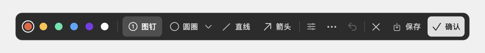

# Nebula ScreenShot

轻量的 macOS 菜单栏截图工具，支持编号图钉、图形标注、平滑画笔、贝塞尔曲线和图片文字提取。所有截图与识别均在本机处理。

[**下载最新版**](https://github.com/AnthemZhou/Nebula-ScreenShot/releases/latest) · [使用指南](docs/USAGE.md) · [更新日志](CHANGELOG.md) · [English](#english)

## 安装

1. 从发行页下载 **Universal ZIP**，解压，将 **Nebula ScreenShot.app** 拖入「应用程序」并打开。支持 macOS 14+、Apple Silicon 和 Intel。
2. 按 **⌃⇧⌘5**（Control + Shift + Command + 5），按系统提示允许**屏幕录制**；入口在「系统设置 → 隐私与安全性 → 屏幕与系统音频录制」。
3. 若要求「退出并重新打开」，按提示操作，应用会自动恢复快捷键。

**登录时启动默认开启：**登录后在后台恢复快捷键，不弹主窗口；可在菜单栏 → 设置 → 登录时启动关闭，之后升级也会保留选择。

当前发行包未公证。若 macOS 阻止打开，请确认下载来源后按 [Apple 官方说明](https://support.apple.com/zh-cn/102445) 操作；升级可能需要重新授权。权限异常或快捷键冲突见[常见问题](docs/USAGE.md#常见问题)。

## 使用

按 **⌃⇧⌘5** 拖选区域，标注后按 **回车 / ⌘C** 复制图片并退出，再用 **⌘V** 粘贴。默认不保存文件。

| 操作 | 手势 / 快捷键 |
| --- | --- |
| 编号图钉 | 默认模式下左键单击；悬停点「−」删除，后续编号自动调整 |
| 圆角虚线框 / 箭头 | 默认模式下左键拖框、右键拖箭头 |
| 圆圈、直线等形状 | 从滑杆按钮的菜单选择；悬停标注后可拖动控制点编辑 |
| 画笔 / 橡皮擦 | **P / E**；画笔支持平滑手绘与贝塞尔曲线，橡皮擦可局部擦除笔迹 |
| 调整截图范围 | 拖动边缘或四角；**空格 + 拖动**平移选区 |
| 撤销 / 重做 | **⌘Z / ⇧⌘Z** |
| 保存 PNG / 取消截图 | **⌘S / Esc**；选区外右键也可退出 |

**画笔与钢笔：**长按画笔按钮，拖到模式后松开即可切换；点模式旁的「默认」保存偏好。贝塞尔模式中单击落点，拖动拉出手柄，点击起点闭合；右键结束路径，之后可编辑节点或点击首尾端点续画。双击节点可整体移动、缩放、旋转路径；按回车先结束变换，再按回车复制。

**提取文字：**点击橡皮擦右侧的文字图标，再拖选文字（**⌘A** 全选），按 **回车 / ⌘C** 复制。截图会保留，可继续选字复制，按 **Esc** 结束。识别默认关闭，支持中英文，不上传图片。

## 开发

需要 **Xcode 16+ / Swift 6**。构建与测试见[开发指南](docs/DEVELOPMENT.md)，参与贡献见 [CONTRIBUTING.md](CONTRIBUTING.md)。问题反馈请[提交 Issue](https://github.com/AnthemZhou/Nebula-ScreenShot/issues)。

## English

A lightweight macOS menu-bar app for screenshots, numbered pins, shapes, smooth freehand, Bézier paths, and text extraction. Capture and OCR run entirely on your Mac.

[**Download the latest release**](https://github.com/AnthemZhou/Nebula-ScreenShot/releases/latest) · [User guide](docs/USAGE.md#english) · [Changelog](CHANGELOG.md)

### Install

1. Download the **Universal ZIP**, unzip it, move **Nebula ScreenShot.app** to **Applications**, and open it. Requires macOS 14+; supports Apple Silicon and Intel.
2. Press **Control + Shift + Command + 5** and allow **Screen Recording** in **System Settings → Privacy & Security → Screen & System Audio Recording**.
3. Follow any **Quit & Reopen** prompt. The app and shortcut recover automatically.

**Launch at Login is enabled by default:** Nebula restores its shortcut in the background without opening the main window. Turn it off in the menu-bar **Settings → Launch at Login**; upgrades preserve your choice.

Current releases are not notarized. If macOS blocks the app, verify the download source and follow [Apple’s instructions](https://support.apple.com/102445). Upgrades may require screen-recording consent again. For permission trouble, use the app’s **Settings → Reauthorize Screen Recording…** menu; for shortcut conflicts, use **Check Shortcut…**.

### Use

Press **Control + Shift + Command + 5**, drag a region, and annotate. **Return / ⌘C** copies the image and closes the editor; **⌘V** pastes it. Files are saved only when you choose to save them.

| Action | Gesture / shortcut |
| --- | --- |
| Numbered pins | Click in the default mode; hover and click “−” to delete and renumber |
| Rounded dashed rectangle / arrow | Left-drag / right-drag in the default mode |
| Circles, lines, and other shapes | Choose from the sliders menu; hover and drag control points to edit |
| Pen / eraser | **P / E**; smooth freehand or Bézier paths, with partial stroke erasing |
| Resize / move the crop | Drag an edge or corner / **Space + drag** |
| Undo / redo | **⌘Z / ⇧⌘Z** |
| Save PNG / cancel | **⌘S / Esc**; right-click outside the crop also exits |

**Pen modes:** Hold the pen button, drag to a mode, and release. Select **Default** beside a mode to remember it. In Bézier mode, click to place anchors, drag to create handles, and click the first anchor to close. Right-click inside the crop to finish; existing nodes remain editable, and either endpoint of an open path can resume drawing. Double-click a node to move, scale, or rotate the whole path; Return ends transform mode, and another Return copies the image.

**Extract text:** Click the text icon beside the eraser, drag to select text (**⌘A** selects all), then press **Return / ⌘C**. The editor stays open for repeated selections and copies; press **Esc** to finish. OCR is opt-in, supports Chinese and English, and never uploads images.

**Development:** Requires **Xcode 16+ / Swift 6**. See the [development guide](docs/DEVELOPMENT.md), [contribution guide](CONTRIBUTING.md), or [report an issue](https://github.com/AnthemZhou/Nebula-ScreenShot/issues).

## License

[GPL-3.0-only](LICENSE) · 第三方来源与许可 / Third-party credits: [THIRD_PARTY_NOTICES.md](THIRD_PARTY_NOTICES.md)
