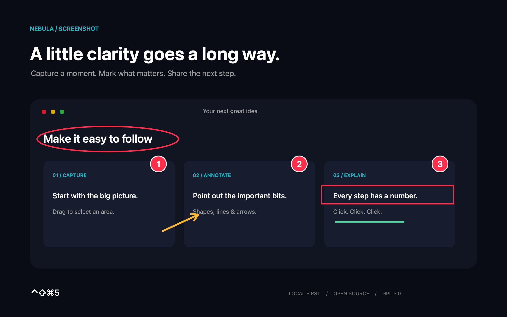
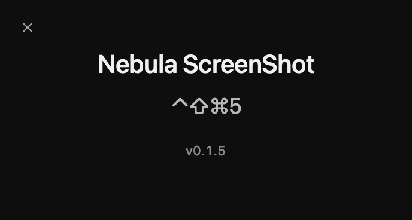

# Nebula ScreenShot

**截取灵感，标记重点。** 一个轻量的 macOS 原生菜单栏截图工具。

按 **Control + Shift + Command + 5**，拖动选区，然后直接圈画、拉线、画箭头，或点击放置连续编号的圆形图钉 **① ② ③**。

[下载](https://github.com/AnthemZhou/Nebula-ScreenShot/releases) · [使用说明](#使用) · [从源码构建](#开发) · [GPL 3.0](LICENSE)



*上图为合成示例画布；圆圈、方框、直线、箭头与编号均由应用的实际导出代码绘制。*

## 标注工具条

深色单行工具条，按顺序提供 **图钉、圆圈 / 方框、直线、箭头**。选区完成后默认使用图钉；形状旁的下拉按钮切换圆圈和方框。颜色与粗细收进样式菜单，保存、重选等操作位于更多菜单。


## 窗口

黑白小窗口仅显示 **Nebula ScreenShot、⌃⇧⌘5、版本号**。点击菜单栏 →「关于 Nebula ScreenShot」可打开；按 Esc 关闭。截图快捷键直接进入选区，不经过此窗口。



## 功能

- 全局快捷键 **⌃⇧⌘5** 直接截图，与菜单栏入口；使用独占注册，避免多个 Carbon 快捷键监听者同时响应。
- 拖动选择屏幕区域，原地显示悬浮标注工具条。
- 四组标注工具：编号图钉、圆圈 / 方框、直线、箭头。
- **连续编号图钉**：选择图钉工具后，在选区内依次点击，生成圆圈内的 1、2、3……；每张新截图从 1 开始。
- 样式菜单提供五种颜色、三档线宽；主栏可撤销，更多菜单可重做、清空标注、重新选区。
- 编辑后点击「确认」或按 Enter，默认将 PNG / TIFF 复制到剪贴板；也可主动保存 PNG，保留 Retina 分辨率。
- 可在任意一块显示器上选择区域；一次选区限制在单块显示器内。
- 自带无需屏幕录制权限的示例画布，便于试用标注。
- 截图仅在本机内存中处理。没有账户、联网上传、埋点或第三方依赖。

## 安装

要求 **macOS 14 Sonoma 或更新版本**。Universal 发布包包含 Apple Silicon 和 Intel 两种架构。

1. 从 [Releases](https://github.com/AnthemZhou/Nebula-ScreenShot/releases) 下载 ZIP 并解压。
2. 将 **Nebula ScreenShot.app** 拖入「应用程序」文件夹（或 `~/Applications`），再打开。请使用固定目录中的这一份应用，不要从同步的源码 / `dist` 目录长期运行。
3. 应用常驻菜单栏，关闭说明窗口不会退出应用。

首版采用 ad-hoc 签名，**尚未经过 Apple Developer ID 签名与公证**。从网络下载后，macOS 可能阻止首次打开。确认来源后，可在「系统设置 → 隐私与安全性」中使用「仍要打开」，也可在本机从源码构建。不需要关闭 Gatekeeper。

### 首次设置

**屏幕权限**：打开「系统设置 → 隐私与安全性 → 屏幕与系统音频录制」（部分系统称「屏幕录制」），允许 Nebula ScreenShot。若系统要求，请退出并重新打开应用。应用只请求画面捕获，不录制音频。

**开关已开，却反复提示权限**：预览版使用 ad-hoc 签名，更新后系统可能仍保存旧版的签名授权；仅切换开关不能保证清除旧记录。请使用菜单栏 →「设置」→「重新授权屏幕录制…」，确认后应用只清除 **Nebula 自己的屏幕录制授权**，重新启动并请求授权。允许当前版本后再截图。也可在权限失败提示中点击「重新授权」。不会修改其他应用的权限。

正式的跨版本授权需要稳定的 Apple 代码签名身份；固定安装目录本身不能消除 ad-hoc 签名变化。[Apple 对此问题的说明](https://developer.apple.com/forums/thread/819406)。

**快捷键检查**：默认快捷键为 **⌃⇧⌘5**，应用以独占方式注册。部分 macOS 配置会将它作为系统截屏快捷键的变体保留；出现在系统保留列表中，并不等于注册失败。菜单栏 →「设置」→「重新检测快捷键」会显示实际注册结果；其他应用独占此组合时，退出该应用后可重新检测。

如果按下后仍出现系统截屏面板，请检查「系统设置 → 键盘 → 键盘快捷键 → 截屏 → 截屏和录制选项」。独占注册不等于禁用系统快捷键，应用不会修改系统设置或请求额外的键盘监听权限。Apple 文档说明 **⇧⌘5** 用于打开截屏与录屏工具，但未单独说明加 Control 的变体：[Apple 使用说明](https://support.apple.com/en-euro/guide/mac-help/mh26782/mac)。

即使快捷键被占用，仍可点击菜单栏图标 →「区域截图」。权限和快捷键检查入口统一位于菜单栏 →「设置」。

## 使用

1. 按 **⌃⇧⌘5** 或点击菜单栏「区域截图」。
2. 按住鼠标拖出截图区域，松开后出现工具条。
3. 选择工具并在选区内标注。选择「图钉」后，每点击一次添加一个带递增数字的圆圈。
4. 点击工具条右侧的 **勾号（确认）**，或按 **Enter / ⌘C**，截图即复制到剪贴板并结束编辑，可直接 **⌘V** 粘贴。需要文件时，使用「更多 → 保存 PNG」或按 **⌘S**。

| 操作 | 快捷键 |
| --- | --- |
| 圆圈 / 椭圆 | O |
| 方框 / 矩形 | B |
| 直线 | L |
| 箭头 | A |
| 连续编号图钉 | N |
| 撤销 / 重做 | ⌘Z / ⇧⌘Z |
| 确认并复制到剪贴板 | Enter / ⌘C |
| 保存 PNG | ⌘S |
| 重新选择区域并清空标注 | R |
| 取消截图 | Esc |
| 正圆 / 正方形 / 水平或垂直线、箭头 | 拖动时按住 Shift |

工具快捷键仅在截图编辑期间生效。撤销图钉后继续点击，会使用当前下一个序号。取消保存对话框会回到原选区，保留已有标注。工具条与选区边框不会进入导出图片。

## 开发

需要 Xcode 16 或更新版本，以及 Swift 6 工具链。工程使用 Swift Package Manager，可直接用 Xcode 打开 `Package.swift`。只依赖系统框架 AppKit、ScreenCaptureKit 与 Carbon。

```sh
git clone https://github.com/AnthemZhou/Nebula-ScreenShot.git
cd Nebula-ScreenShot
swift test
./scripts/build.sh
open "dist/Nebula ScreenShot.app"
```

为保证系统权限归属于正确应用，实际截图请运行打包后的 `.app`，不要使用 `swift run` 请求屏幕权限。

生成同时支持 Apple Silicon / Intel 的发布包：

```sh
./scripts/package.sh --universal
```

输出位于 `dist/`，包含 ZIP 和 SHA-256 校验文件。默认 ad-hoc 签名；可通过 `CODE_SIGN_IDENTITY` 指定自己的签名身份。本地开发应使用固定的 Apple Development 身份，以便跨构建保持 TCC 授权；面向用户的发行应使用 Developer ID Application。Developer ID 正式分发还需自行配置 hardened runtime、notarization 与 stapling；此脚本不宣称完成公证。

实际权限验证请从最终 ZIP 安装后，通过 Finder / `open` 启动 `.app`。直接运行包内二进制可能让权限归属启动它的终端或开发工具，不能据此判断应用本身是否获准。应用记录截图请求、选区就绪及错误 domain/code，不记录屏幕内容：

```sh
open "$HOME/Applications/Nebula ScreenShot.app" --args --capture
log show --last 5m --style compact --predicate 'subsystem == "io.github.anthemzhou.NebulaScreenShot" AND category == "Capture"'
```

`--capture` 在应用启动时直接开始一次截图；应用已运行时请使用快捷键。更新后若需命令行恢复，只重置此应用：`tccutil reset ScreenCapture io.github.anthemzhou.NebulaScreenShot`，然后重新启动并授权。

示例画布与可重现的渲染预览：

```sh
open "dist/Nebula ScreenShot.app" --args --demo
"dist/Nebula ScreenShot.app/Contents/MacOS/NebulaScreenShot" --render-demo docs/preview.png
"dist/Nebula ScreenShot.app/Contents/MacOS/NebulaScreenShot" --render-welcome docs/welcome.png
"dist/Nebula ScreenShot.app/Contents/MacOS/NebulaScreenShot" --render-toolbar docs/toolbar.png
```

### 结构

- `Sources/NebulaCore`：标注数据、事务式撤销/重做、坐标换算、预览与导出共用渲染器。
- `Sources/NebulaScreenShot`：菜单栏、快捷键、屏幕捕获、选区、工具条与引导窗口。
- `Tests/NebulaCoreTests`：编号及分支撤销、Retina 选区裁剪、箭头几何、像素方向与导出位置测试。
- `.github/workflows/build.yml`：macOS 自动测试、Universal 构建和构建产物上传。

手动验收步骤见 [TESTING.md](TESTING.md)。欢迎提交 Issue 与 Pull Request。

## License

Copyright © 2026 Nebula ScreenShot contributors.

本项目使用 **GNU General Public License v3.0 only (`GPL-3.0-only`)**，全文见 [LICENSE](LICENSE)。

---

**English:** Nebula ScreenShot is a native, local-only macOS menu bar screenshot annotator. Press Control–Shift–Command–5 to capture directly, select a region, then use the compact dark toolbar for numbered pins, ellipses/rectangles, lines and arrows. Click the checkmark or press Enter to copy the annotated image to the clipboard by default. Colors and stroke widths live in the style menu; saving a Retina-resolution PNG is available in More. The compact About window uses only black, white and neutral gray. Requires macOS 14+. The global shortcut uses exclusive registration; if the system screenshot panel still appears, adjust the conflicting system binding. The app is ad-hoc signed and not notarized. Licensed under GPL-3.0-only.
