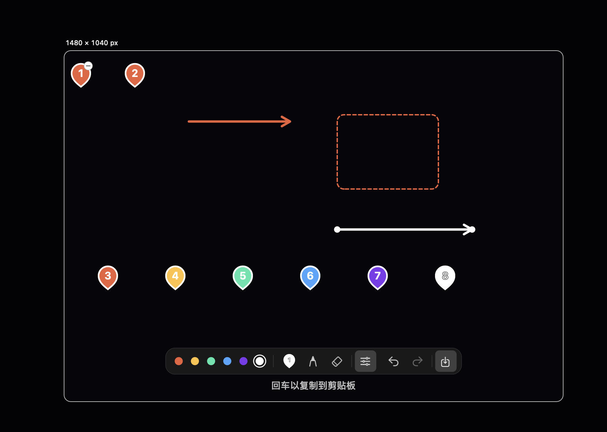

# Nebula ScreenShot

轻量的 macOS 菜单栏截图与标注工具。按 **⌃⇧⌘5** 拖选区域，添加编号图钉、图形或手绘标记，再按 **回车** 复制到剪贴板。

**当前版本：v1.1.4** · macOS 14+ · Apple Silicon / Intel · GPL-3.0-only

[**下载 v1.1.4（Universal ZIP）**](https://github.com/AnthemZhou/Nebula-ScreenShot/releases/download/v1.1.4/Nebula-ScreenShot-1.1.4-universal.zip) · [发行说明](https://github.com/AnthemZhou/Nebula-ScreenShot/releases/tag/v1.1.4) · [安装](#安装) · [首次授权](#首次授权) · [使用](#使用) · [快捷键](#快捷键) · [常见问题](#常见问题)

## 安装

1. 下载上方的 **`Nebula-ScreenShot-1.1.4-universal.zip`**。同一个安装包适用于 Apple Silicon 和 Intel，无需选择架构；GitHub 的 `Source code` 是源码，不是应用安装包。
2. 双击 ZIP 解压，将 **Nebula ScreenShot.app** 拖入「应用程序」文件夹，再从那里打开。也可以安装到用户自己的 `~/Applications`，后续更新请沿用同一位置。
3. 在屏幕顶部菜单栏找到 Nebula 的取景框图标。应用常驻菜单栏；关闭「关于」窗口不会退出应用。

**首次打开被 macOS 阻止？** 当前下载包尚未经过 Apple Developer ID 签名与公证。确认文件来自本仓库的 Release 后，先尝试打开一次，再到 **系统设置 → 隐私与安全性 → 仍要打开**，按系统提示确认。详见 [Apple 的打开说明](https://support.apple.com/zh-cn/102445)。

需要核对下载文件时，可使用发行页附带的 [SHA-256 校验文件](https://github.com/AnthemZhou/Nebula-ScreenShot/releases/download/v1.1.4/Nebula-ScreenShot-1.1.4-universal.zip.sha256)。

## 首次授权

首次截取真实屏幕需要允许 macOS 的屏幕录制权限。**打开应用的确认和屏幕录制授权是两件事。**

1. 打开应用后，按 **Control + Shift + Command + 5**，或点击菜单栏图标 → **区域截图**，触发系统授权请求。
2. 在 macOS 提示中允许 Nebula ScreenShot；若提示打开设置，进入 **系统设置 → 隐私与安全性 → 屏幕与系统音频录制**，打开 **Nebula ScreenShot** 的开关。不同系统版本也可能将这一项称为「屏幕录制」或「录屏与系统录音」。
3. 如果系统要求退出并重新打开，按提示操作。应用会自动恢复运行和快捷键，然后再次按 **⌃⇧⌘5** 开始截图。

通常无需手动把应用添加到权限列表。找不到应用或开关已开却仍不能截图时，请看下方的 [常见问题](#常见问题)。系统权限的位置也可参阅 [Apple 说明](https://support.apple.com/zh-cn/guide/mac-help/mchld6aa7d23/mac)。

Nebula 只捕获屏幕画面，不录制音频。想先熟悉标注，可选择菜单栏 → **试用标注…**，使用不需要屏幕录制权限的示例画布。

## 使用

1. 按 **⌃⇧⌘5**：屏幕变暗，光标变为十字准星。
2. **按住左键拖选区域**，松开后出现标注工具栏。截图画面准备期间可按 Esc 取消。
3. 默认使用图钉模式：**点击打钉、左键拖框、右键拖箭头**。需要圆圈、直线或画笔时，从工具栏或快捷键切换。
4. 按 **Return / Enter** 或 **⌘C** 复制并结束截图，然后在聊天、文档等支持图片的应用中按 **⌘V** 粘贴。

默认复制到剪贴板，**不会自动保存文件**。需要 PNG 文件时，点击工具栏的保存图标，或按 **⌘S**；取消保存对话框会返回原选区，保留已有标注。按 **Esc** 可取消截图。

### 标注手势

以下前三项是在默认图钉模式（按 **N** 切回）下最常用的操作。按住鼠标即可直接拖动，无需等待长按计时。

| 想做什么 | 如何操作 |
| --- | --- |
| 添加编号图钉 | 在选区空白处左键单击，依次生成 1、2、3……；每张新截图从 1 开始 |
| 画圆角方框 | 在选区空白处按住左键拖动，生成细线、圆角、虚线矩形 |
| 画箭头 | 在选区内按住右键拖动；其他工具模式下也可使用 |
| 画圆圈、矩形、直线或箭头 | 从滑杆图标菜单选择形状，再按住左键拖动 |
| 手绘 | 选择画笔（P），按住左键绘制 |
| 擦除 | 选择橡皮擦（E），按住左键涂抹；手绘笔触只擦去经过的部分，图钉和几何图形按整个对象擦除 |
| 删除图钉 | 移开后重新悬停图钉，点击出现的「−」；后面的图钉会自动重新编号 |
| 调整已有标注 | 使用图钉或形状工具，悬停后拖动端点或控制点；拖动标注本体可平移 |
| 调整截图范围 | 鼠标靠近选区边缘或四角，出现高亮后拖动 |
| 平移截图范围 | 在选区内按住空格，再按住左键拖动 |
| 退出截图 | 按 Esc，或在画布空白处右键单击；右键拖动选区内会画箭头 |

选区采用圆角细白实线，鼠标靠近边缘时高亮。圆角仅用于编辑界面，导出的图片仍为完整矩形。调整截图范围时，已有标注保留在原画面位置，最终导出按新的选区裁剪。每个选区位于一块显示器内，支持在不同显示器上分别截图。

### 工具栏

从左到右是 **六种颜色 → 图钉 → 画笔 → 橡皮擦 → 形状与设置 → 撤销 → 重做 → 保存 PNG**。按钮仅显示图标，鼠标停留可查看提示。复制入口是工具栏下方的 **「回车以复制到剪贴板」**。

- 默认使用蓝色；切换颜色只影响后续标注。
- 滑杆图标菜单包含圆圈、方框、直线、箭头，以及线条 / 画笔粗细。圆角虚线方框固定使用细线。
- 导出期间显示「正在导出…」并暂时锁定编辑，Esc 仍可取消，避免重复复制或丢失新画的标记。
- 界面跟随系统或应用语言设置，支持中文和英文。macOS 26 使用原生 Liquid Glass，较早系统使用毛玻璃；上图为静态布局预览。

工具栏、选区边框、编辑控制点和删除按钮都不会进入导出的图片。

查看标注效果与二次编辑示例

以上均为合成画布，标记由应用的实际渲染代码绘制；编辑器预览使用静态工具栏底色。

## 快捷键

**⌃ = Control，⇧ = Shift，⌘ = Command。** 只有「开始截图」是全局快捷键，其余操作在截图编辑期间使用。

| 操作 | 快捷键 |
| --- | --- |
| 开始截图 | **⌃⇧⌘5** |
| 复制并结束截图 | **Return / Enter** 或 **⌘C** |
| 保存 PNG | **⌘S** |
| 取消截图 | **Esc** |
| 图钉 / 默认手势 | **N** |
| 圆圈 / 椭圆 | **O** |
| 圆角矩形 | **B** |
| 直线 | **L** |
| 箭头 | **A** |
| 手绘画笔 | **P** |
| 橡皮擦 | **E** |
| 撤销 / 重做 | **⌘Z** / **⇧⌘Z** |
| 删除当前选中的标注 | **Delete / ⌫** |
| 平移选区 | **空格 + 左键拖动** |
| 绘制正圆、正方形，或水平 / 垂直的线与箭头 | **绘制时按住 Shift** |
| 重新选择区域并清空所有标注（无法撤销） | **R** |

## 常见问题

### 快捷键没有反应，或者打开了系统截图工具

1. 先确认 Nebula 的菜单栏图标还在；若已退出，从「应用程序」重新打开。
2. 点击菜单栏 → **区域截图**。如果能正常截图，进入 **设置 → 重新检测快捷键…** 查看注册结果；若提示被其他应用占用，退出或调整该应用后再次检测。
3. 如果出现 macOS 自带的截屏面板，检查 **系统设置 → 键盘 → 键盘快捷键 → 截屏** 中的冲突项。Nebula 使用的是 **Control + Shift + Command + 5**，请确认没有漏按 Control。

### 权限列表里没有 Nebula，或者已经允许却仍提示授权

先从菜单栏 → **设置 → 屏幕录制权限…** 发起系统请求。仍异常时，使用 **设置 → 重新授权屏幕录制…**；授权失败后，主菜单也会出现 **修复屏幕录制授权…**。这会重置 Nebula 自己的屏幕录制记录并重新请求授权，需要你再次允许。

若系统列表仍未更新，可在该权限页面点「＋」，选择安装在「应用程序」或 `~/Applications` 中的 **Nebula ScreenShot.app**，再按系统提示重新打开。

### 更新后是否需要重新授权

当前发行包采用临时签名，更新后 **可能需要重新允许屏幕录制**。升级时先退出旧版，再用新版覆盖原安装位置；不要同时运行下载目录和应用目录中的两份应用。遇到授权循环，可按上一项重新授权。

### 复制后找不到图片文件

默认输出在剪贴板，直接 **⌘V** 粘贴即可。需要磁盘文件时，用 **⌘S** 或工具栏保存图标选择 PNG 保存位置。

### 截图会上传吗

不会。截图和标注在本机处理，没有账号、云端上传或埋点；只有主动保存时才生成图片文件。复制后的图片由你自行粘贴到目标应用。

## v1.1.4 更新

- 更快进入截图：截图、暗色遮罩和标注分层绘制，减少全屏重绘；同时修复入场时顶层窗口阴影跳变。
- 修复点击「打开系统设置」后重复出现同一授权提示的问题，等待授权时不再持续轮询权限。
- 选区改为细白色圆角实线，保留边缘悬停高亮和拖动调整，导出仍为完整矩形。
- 改善小截图中的图钉删除按钮：更靠近图钉、保持数字清晰，删除更容易点中；降低选区边缘拖动与标注编辑之间的误触。
- 换用黑白圆角应用图标。

本机双屏实测中，从快捷键回调到选区就绪，首次约 **201 ms**，随后三次约 **70–94 ms**；速度受设备、显示器和系统状态影响。用户已确认进入明显更快，拖选和标注正常。

55 项核心测试、中英文编辑交互、100 次快捷键投递、100 次快速取消、50 次截图复制及窗口释放检查已通过。完整记录见 [CHANGELOG.md](CHANGELOG.md)，性能与桌面验收见 [选区改进记录](docs/ROUNDED_SELECTION_EXPERIMENT.md)。

## 开发

从源码构建需要 **Xcode 16+ / Swift 6**；构建原生 Liquid Glass 界面需要 **Xcode 26+**。工程使用 Swift Package Manager，仅依赖 macOS 系统框架。

构建命令、测试、诊断日志与目录结构见 [开发与调试指南](docs/DEVELOPMENT.md)。参与贡献请阅读 [CONTRIBUTING.md](CONTRIBUTING.md)，手动验收见 [TESTING.md](TESTING.md)。遇到问题可 [提交 Issue](https://github.com/AnthemZhou/Nebula-ScreenShot/issues)，附上应用版本、macOS 版本和复现步骤。

English quick start

Requires macOS 14 or later. [Download v1.1.4](https://github.com/AnthemZhou/Nebula-ScreenShot/releases/download/v1.1.4/Nebula-ScreenShot-1.1.4-universal.zip), unzip, move **Nebula ScreenShot.app** to Applications, and open it. The Universal app supports Apple Silicon and Intel. This release is ad-hoc signed and not notarized; if macOS blocks it, follow [Apple’s opening instructions](https://support.apple.com/102445) after verifying its source.

Press **Control–Shift–Command–5** and allow screen recording when macOS asks. Follow any quit/reopen prompt; Nebula restores its menu-bar app and shortcut automatically. Press the shortcut again and drag a region. In the default pin mode, click to number points, left-drag a rounded rectangle, and right-drag an arrow. The slider menu contains shapes and stroke widths; pen, eraser, undo/redo and PNG save are on the toolbar.

Press **Return / Command–C** to copy, **Command–S** to save PNG, or **Esc** to cancel. Canceling Save returns to the editor. Screenshots stay on your Mac. An upgrade may require screen-recording consent again with the current ad-hoc releases.

## License

本项目采用 **GNU General Public License v3.0 only（GPL-3.0-only）**，完整协议见 [LICENSE](LICENSE)。

Copyright © 2026 Nebula ScreenShot contributors.
