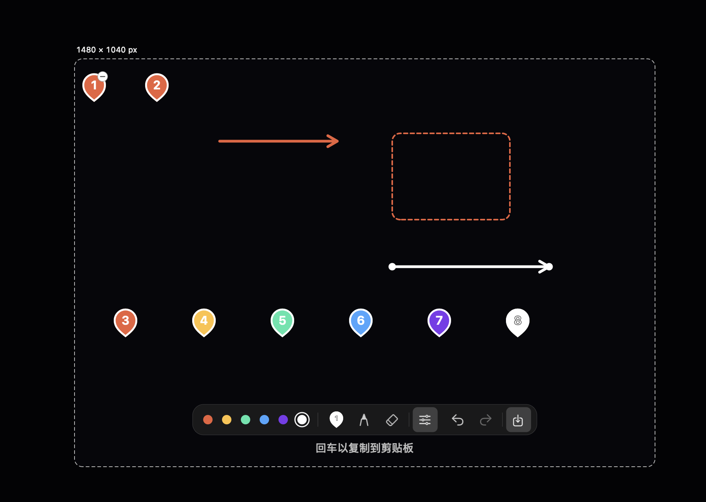

# 圆角虚线选区试验

分支：`codex/rounded-dashed-selection`。

上一轮 v1.1.4 的小选区编辑修正与黑白图标已单独保存在基线提交 `f9e6114`。本试验基于该提交，应用版本为 1.1.4，构建号为 23。

- 选区显示为圆角开口，使用静态的细白色虚线描边。
- 圆角半径最大 10 pt；小选区的圆角和虚线长度随尺寸缩小。
- 悬停及拖动时，仅对应边缘或圆角的虚线增强亮度，保持同一条轮廓和虚线相位。
- 圆角弧线可直接拖动；保留小图钉删除、贴边标注编辑与拖动防抖逻辑。
- 圆角是编辑界面的显示效果。剪贴板和 PNG 仍导出矩形范围内的完整画面，边框和遮罩不会进入图片。

验证：53 项核心测试及中英文 AppKit 编辑交互检查通过，覆盖圆角拖动、8–100 pt 小选区、图钉删除、遮罩加载前后的圆角一致性和矩形导出。

预览使用实际绘制代码与合成画布；工具栏为静态材质。
